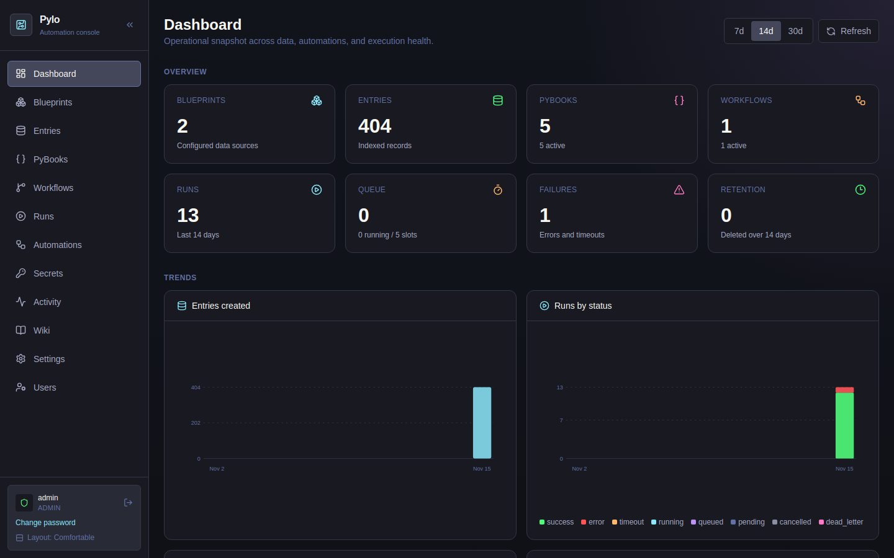
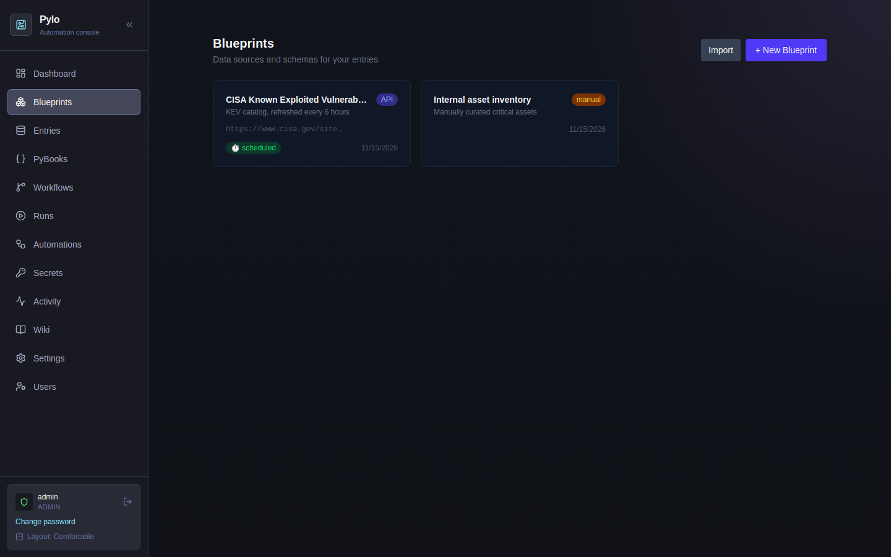
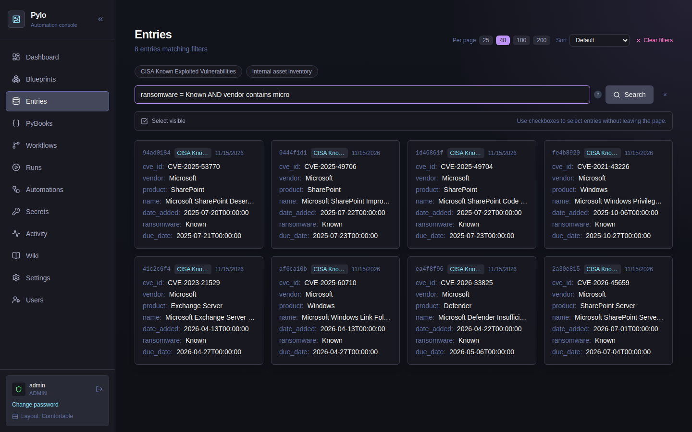
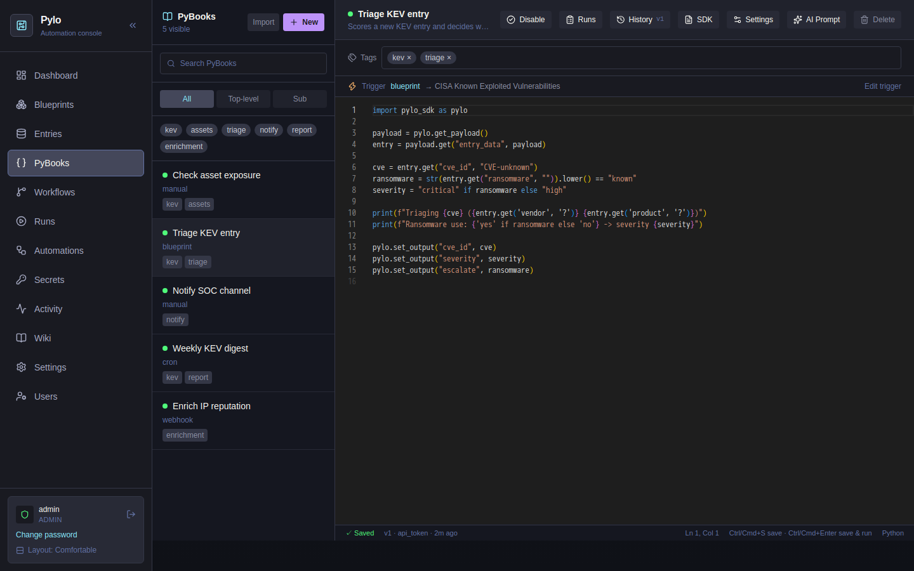
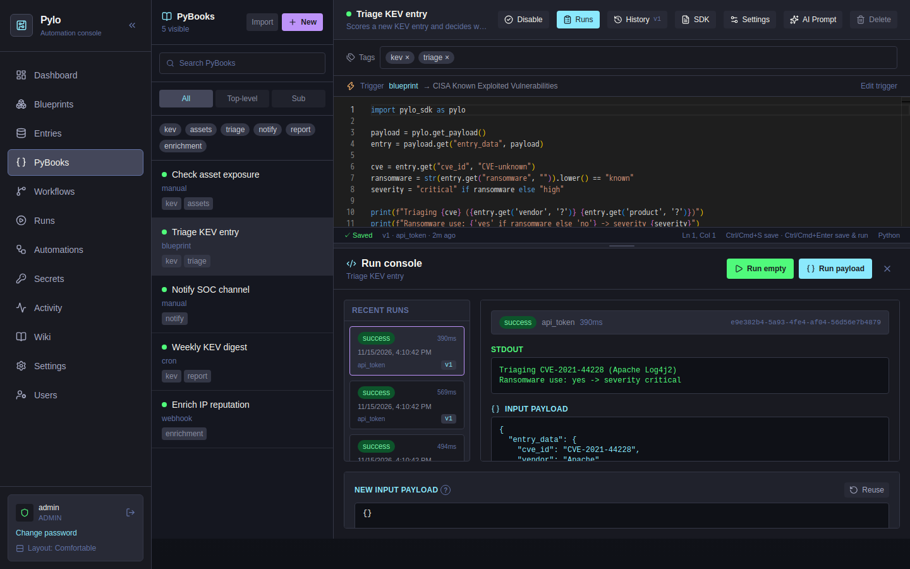
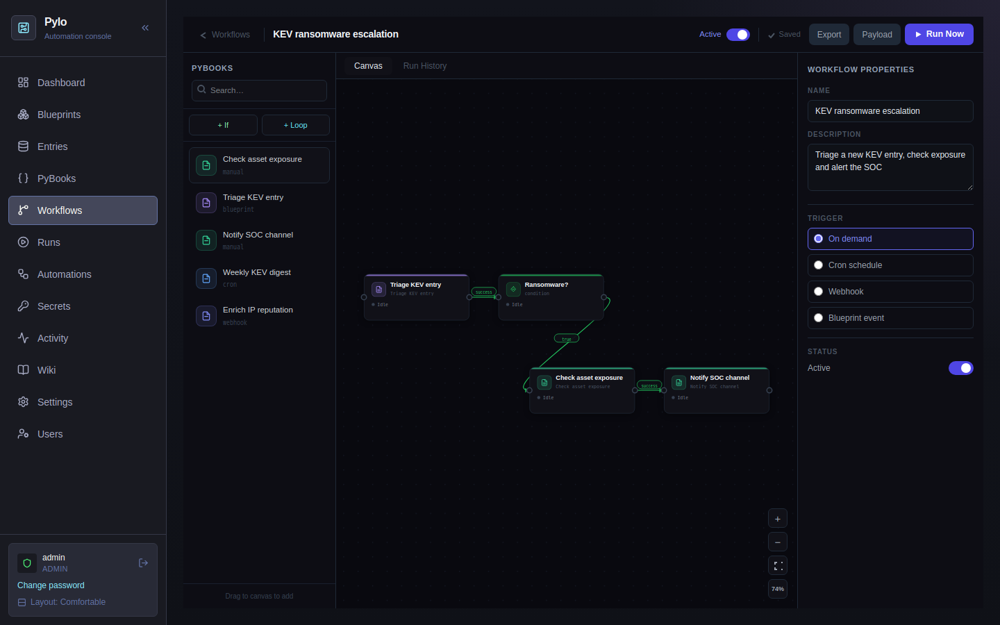
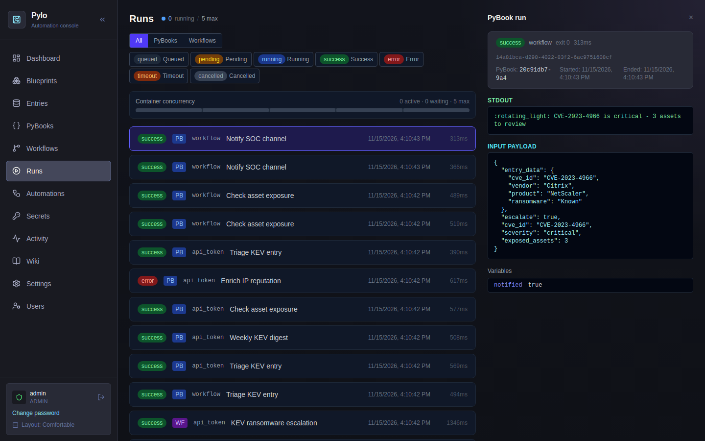
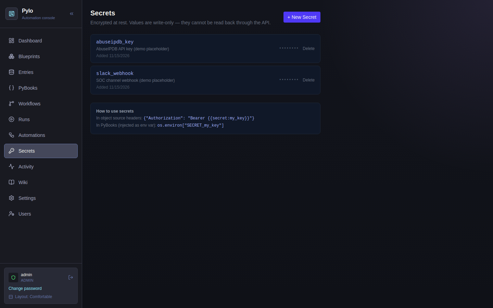
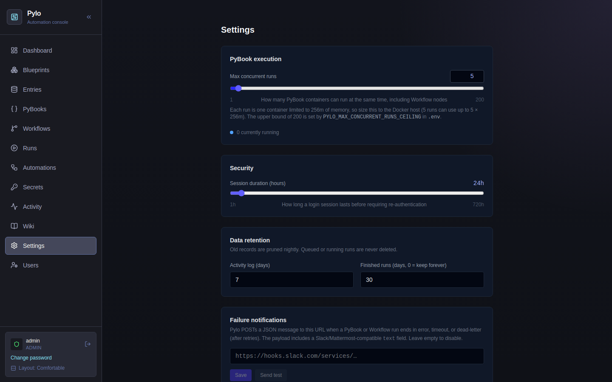

# Pylo

Pylo is a Python automation orchestration platform for SOAR and general-purpose data pipelines. It combines API ingestion, normalized Entries, isolated Python execution, visual Workflows, scoped API keys, encrypted secrets, and an operator-friendly web UI.

Pylo is built for security analysts, DevOps engineers, and code-first automation users who want automation that stays inspectable and scriptable.



## V1 Scope

Pylo V1 focuses on a stable automation core:

- **Blueprints** fetch structured data from external REST APIs with authentication, pagination, retries, fetch limits, and on-fail behavior.
- **Entries** store normalized records from Blueprints, support deduplication, mutable fields, history, search, filtering, and bulk actions.
- **PyBooks** run Python scripts in isolated ephemeral Docker containers with payloads, scoped API access, network controls, and selected secrets injected as environment variables.
- **Workflows** orchestrate PyBooks with branching, loops, multiple outgoing connections, payload mappings, and per-node run history.
- **Runs** provide a persistent async execution queue with live logs, status history, concurrency limits, and orphan recovery after restarts.
- **Secrets and API keys** are designed for least privilege: secrets are encrypted, decrypted values are never returned, and integration API keys can be scoped.
- **Operations** include backup/export, restore/import, system settings, user management, audit activity, and a GitOps-style dev-to-prod promotion flow.

## Feature Tour

### Blueprints (API ingestion)

Blueprints are the data sources that fetch records from external REST APIs. Each one is listed here with its type and schedule, and you open it to review its Entries and Settings.



### Entries (search and filters)

Entries hold the normalized records produced by Blueprints. The search box accepts field filters combined with full-text terms, as described in [Core Concepts](#entries).



### PyBooks (editor)

PyBooks are Python scripts that can be triggered by a Blueprint, cron, webhook or a Workflow. The editor shows the selected script, its tags and trigger, and the SDK and Settings actions above the code.



### Run console (live logs, cancel)

The Runs button opens the run console below the editor. It lists recent runs with their status and shows the captured stdout and the input payload of the selected run. Queued and running runs can be cancelled from the console.



### Workflows (visual graph)

Workflows are drawn as a node graph on a canvas. Each node is a PyBook or a condition, and connections are labelled with the branch they follow, such as `success` or `true`.



### Runs (unified history)

The Runs page lists PyBook and Workflow runs in one history, with status filters and the queue concurrency. Selecting a row opens its details on the right, including stdout and the input payload.



### Secrets

Secrets are stored encrypted and are write-only in the UI: values cannot be read back after creation. The page also shows how to reference a secret from a Blueprint header or as an environment variable in a PyBook.



### Settings

Settings holds the PyBook concurrency limit, session duration, data retention, and the failure-notification webhook.



## Quick Start

### Requirements

- Docker with the Compose plugin
- Git

### Install

```bash
git clone https://github.com/0xRD/pylo
cd pylo
bash setup.sh
```

`setup.sh` prepares a fresh machine by generating `.env`, creating strong runtime secrets, building the PyBook runner base image, starting the Docker Compose stack, and waiting for the backend health check.

Open the app at `http://localhost:3000`, then create the first admin account in the setup wizard.

### Manual Setup

```bash
cp .env.example .env
# Edit .env and set SECRET_KEY, ENCRYPTION_KEY (must differ from SECRET_KEY), API_TOKEN,
# POSTGRES_PASSWORD/DATABASE_URL, and other deployment values. Each key needs 32+ characters:
#   python3 -c "import secrets; print(secrets.token_hex(32))"
mkdir -p pybooks_storage objects_storage
# Linux only: run the backend as the owner of those two directories
echo "PYLO_UID=$(id -u)" >> .env && echo "PYLO_GID=$(id -g)" >> .env
docker build -t pylo-runner-base:2026.05 -f docker/pybook-runner/Dockerfile.base docker/pybook-runner/
docker compose up -d --build
```

Keep `.env` private. It contains deployment secrets and must not be committed.

### Upgrading

```bash
git pull
bash setup.sh        # safe to re-run: keeps your .env, rebuilds and restarts the stack
```

`pybooks_storage/` holds PyBook scripts and `objects_storage/` holds auto-backups and the GitOps working copy. Both live next to `docker-compose.yml` and survive rebuilds; include them (and a database dump) in your host backups. Signing in again is required after upgrading to a release that changes session handling.

## Runtime Services

| Service | Default URL | Purpose |
|---|---|---|
| Frontend | `http://localhost:3000` | React UI served by nginx |
| Backend | `http://localhost:8000` | FastAPI API and queue manager (bound to the host loopback; remote clients use `http://<host>:3000/api`) |
| API docs | `http://localhost:8000/docs` | Interactive OpenAPI docs (enable with `PYLO_EXPOSE_DOCS=true`) |
| Postgres | Compose network only | Runtime database |

Postgres is the supported runtime database. SQLite is deprecated for runtime use and kept only as a temporary recovery path when explicitly enabled.

The backend applies Alembic migrations on startup. Postgres is not published to the host by default; protect shell access and Docker access as privileged infrastructure.

## Core Concepts

### Blueprints

Blueprints describe how to fetch and parse structured data from external APIs. A Blueprint can define request method, headers, body, authentication, pagination, item extraction path, field mappings, deduplication key, fetch limits, retry policy, retention, and auto-fetch schedule.

Secrets can be referenced in Blueprint headers as `{{secret:name}}`; values are resolved only at fetch time and are never logged or returned by the API.

### Entries

Entries are instances produced by Blueprints or created manually. They keep raw source data, parsed fields, history, mutable values, and full-text search metadata. Field filters are evaluated server-side so pagination remains correct.

Example queries (the search box on any Entries view):

```text
severity = "high"
category contains "malware"
score >= 80
status != "closed" AND owner starts_with "secops"
hostname ends_with ".corp.example" OR mimikatz
```

Field filters support `=`, `!=`, `contains`, `starts_with`, `ends_with` and the numeric comparisons `>`, `>=`, `<`, `<=` (non-numeric values never match a numeric comparison). Anything that is not a field filter is full-text search: `a b` (both words), `a OR b`, `a NOT b`, `"exact phrase"` and `prefix*`. Filters and full-text terms can be combined with `AND` / `OR`.

### PyBooks

PyBooks are Python scripts executed in short-lived Docker containers. They can be triggered manually, by cron, by webhook, by Blueprint Entry events, or from Workflows.

Each PyBook can receive a JSON payload, use the mounted SDK, export output variables, and access only the selected secrets/API credentials explicitly configured in the UI.

```python
import os
import pylo_sdk as pylo

payload = pylo.get_payload()
api_key = os.environ["SECRET_virustotal_key"]

matches = pylo.search_entries(payload.get("query", ""))
pylo.set_output("match_count", len(matches))
```

Each PyBook has a network policy, set in its Settings panel and enforced by Docker networking (not by the script):

| Policy | What the PyBook can reach |
|---|---|
| **Default** | The internet and the Pylo API (for the SDK). Never the database or the Docker API. |
| **Allowlisted** | Only the listed hosts, plus the Pylo API. Everything else is blocked. |
| **None** | Nothing: the container has no network interface, so the SDK is unavailable too. |

Allowed hosts are a JSON list of hostnames; a hostname also covers its subdomains:

```json
["api.abuseipdb.com", "api.github.com"]
```

Use hostnames only, not full URLs. An allowlisted PyBook runs on an internal network with no route out. Its only exit is Pylo's egress proxy, which identifies the run by its short-lived token, connects only to that PyBook's allowed hosts and refuses private or internal addresses. `requests`, `httpx`, `urllib` and `curl` pick the proxy up automatically from `HTTPS_PROXY`; code that opens raw sockets is simply blocked. The same policy applies when the PyBook runs as a Workflow node.

Containers run as an unprivileged user with a read-only filesystem, no Linux capabilities, and memory, CPU and process limits. A run that exceeds `PYLO_TIMEOUT_SECONDS` is killed and marked `timeout`.

### Workflows

Workflows chain PyBooks into automation graphs. Nodes can branch on success or failure, use conditional expressions, loop over data, fan out through multiple connections, and map variables from upstream node outputs into downstream payloads.

Workflow runs are tracked separately from PyBook runs and are also visible in the unified Runs page.

### Runs and Queue

Every PyBook execution is written to the database as `queued` before it is enqueued. The run lifecycle is:

```text
queued -> pending -> running -> success | error | timeout | cancelled
```

Logs stream into the run console while a run is still executing, and stdout and stderr are both kept when a script fails or times out (each capped at 1 MB, keeping the end). Any queued or running run can be cancelled from the run console or the Runs page; cancelling a running run stops its container. Cancelling a Workflow run also stops the nodes that are executing.

The queue is persistent and recovers orphaned runs after backend restarts. Set a failure-notification webhook in Settings to have Pylo POST a JSON message (with a Slack/Mattermost-compatible `text` field) whenever a PyBook or Workflow run ends in `error`, `timeout`, or `dead_letter` after its retries. The message includes the last 500 characters of the run's stderr, so avoid printing secrets in PyBooks. Finished runs are pruned nightly after the retention window configured in Settings (30 days by default, `0` keeps them forever). The default concurrency is 5 simultaneous runs (`PYLO_MAX_CONCURRENT_RUNS`) and can be adjusted live from Settings without restarting the backend, up to `PYLO_MAX_CONCURRENT_RUNS_CEILING` (200 by default). The limit counts containers: a standalone PyBook run and a Workflow node each take one slot, so a Workflow loop over many items never starts more containers than the limit. Each container is capped at `PYLO_MEM_LIMIT` (256 MB) and `PYLO_CPU_QUOTA` (half a core), so size the limit to the Docker host.

## Automating Pylo with an LLM agent

[`skills/pylo`](skills/pylo/SKILL.md) is an agent skill that lets an LLM (Claude Code, the Claude Agent SDK, or any agent that reads `SKILL.md` files) build and operate automations on its own: write and test PyBooks, assemble Workflows from a JSON definition, run them and read per-node results. It ships a dependency-free command line client, which is also handy for scripts:

```bash
export PYLO_URL=http://localhost:8000 PYLO_API_TOKEN=<API_TOKEN from .env>
python3 skills/pylo/scripts/pylo_cli.py status
python3 skills/pylo/scripts/pylo_cli.py run-pybook "My PyBook" --payload '{"ip": "203.0.113.9"}'
python3 skills/pylo/scripts/pylo_cli.py save-workflow @workflow.json
```

To install it for Claude Code, copy or symlink the folder into your skills directory, for example `cp -r skills/pylo ~/.claude/skills/pylo`. The skill uses the admin `API_TOKEN`, so only give it to agents you would trust with the Pylo UI.

## Authentication and Security

Browser sessions use httpOnly JWT cookies. API clients should use scoped API keys created from Settings whenever possible. The bootstrap `API_TOKEN` in `.env` remains available for administrative automation.

```bash
curl -H "X-API-Token: $API_TOKEN" http://localhost:8000/api/blueprints
curl -H "X-API-Token: $API_TOKEN" http://localhost:8000/api/runs/queue
```

Failed logins are throttled per account and per client IP (HTTP 429 with `Retry-After`). Set `PYLO_COOKIE_SECURE=true` whenever Pylo is served over HTTPS.

Security posture:

- Secrets are encrypted with Fernet and decrypted only at use time.
- Secret values are never returned by the API after creation.
- Secret values must not be logged by Pylo internals.
- Changing or resetting a password signs out every other session of that account, and the last active admin cannot be removed, demoted or disabled.
- PyBook containers run on dedicated networks that cannot reach the database or the Docker API, and "allowlisted" PyBooks can only leave through an authenticated egress proxy.
- GitOps remotes must be `https://`, `http://` or `ssh://` URLs; other git transports are refused.
- Restoring a backup or importing an export cannot write outside PyBook storage, and only known settings are restored.
- API keys are stored hashed and the raw token is shown only once.
- Blueprint fetches block private, loopback, link-local, reserved, multicast, and metadata-style targets by default.
- PyBook network access can be removed entirely or restricted to allowed hosts (enforced, see PyBooks above).
- Docker access should be treated as privileged infrastructure.

## Main Routes

| Route | Description |
|---|---|
| `/dashboard` | Operational overview |
| `/blueprints` | Blueprint list and API ingestion setup |
| `/blueprints/:id` | Blueprint Entries and Settings tabs |
| `/entries` | Global searchable Entry view |
| `/entries/:id` | Single Entry detail and history |
| `/pybooks` | PyBook editor, trigger setup, SDK reference, and run console |
| `/workflows` | Visual Workflow editor |
| `/runs` | Unified run history and queue visibility |
| `/secrets` | Encrypted secret management |
| `/settings` | API keys, backups, concurrency, sessions, and system settings |
| `/users` | User management |

## Development

See [`CONTRIBUTING.md`](CONTRIBUTING.md) for running the test suite without Docker. With the stack running:

```bash
docker compose exec -T backend python -m pytest tests/ -v
docker compose exec -T backend alembic upgrade head
cd frontend && npm run build
```

Backend code changes should be followed by:

```bash
docker compose build backend
docker compose up -d backend
```

Frontend code changes should be followed by:

```bash
docker compose build frontend
docker compose up -d frontend
```

## Project Hygiene

Do not commit deployment state or runtime secrets:

- `.env`
- `objects_storage/`
- `pybooks_storage/`
- database files
- build artifacts such as `frontend/dist/`
- local agent or editor context files

Before a release, run the tests, migrations, frontend build, stack health check, and a tracked-file scan for secrets or personal paths.

## Documentation

- [`docs/pylo-spec-v2-en.md`](docs/pylo-spec-v2-en.md) - technical specification
- [`docs/pylo_sdk.md`](docs/pylo_sdk.md) - Python SDK reference (in-container helpers and `PyloClient`)
- [`skills/pylo/SKILL.md`](skills/pylo/SKILL.md) - agent skill and CLI for building PyBooks and Workflows through the API
- [`docs/ROADMAP.md`](docs/ROADMAP.md) - known limitations and planned work
- [`CHANGELOG.md`](CHANGELOG.md) - release notes
- [`CONTRIBUTING.md`](CONTRIBUTING.md) - development setup and contribution guidelines
- [`SECURITY.md`](SECURITY.md) - vulnerability reporting

## License

Pylo is licensed under the Apache License 2.0. See [`LICENSE`](LICENSE).

Apache-2.0 is permissive and business-friendly: it allows use, modification, distribution, private use, and commercial use, while also including an explicit patent grant and preserving notice requirements.
